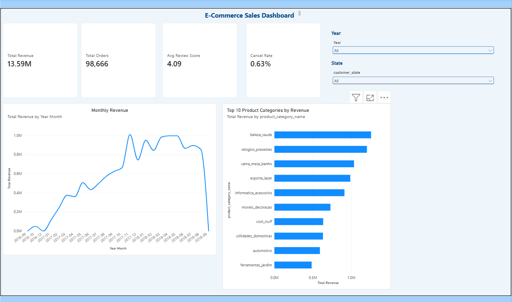

# olist-ecommerce-analysis
# E-Commerce Sales Analysis and QA Testing

A personal project that analyses online shop sales with SQL and Power BI,
and tests a practice e-commerce website with written test cases.

## Project summary

I loaded the Olist Brazilian e-commerce dataset into MySQL, validated the
data, answered business questions with SQL, and built a Power BI dashboard.
Separately, I wrote and ran 30 test cases on a practice shop site.

## Tools used

- MySQL and MySQL Workbench (SQL analysis)
- Power BI Desktop (dashboard and DAX measures)
- Excel / Google Sheets (test cases and summary)
- VS Code, Git and GitHub (version control)

## Dataset

Olist Brazilian E-Commerce Public Dataset (Kaggle):
https://www.kaggle.com/datasets/olistbr/brazilian-ecommerce

The raw CSV files are not included because of their size.

## Key findings

- 98,666 orders with items and about 13.59 million in revenue, an average of about 137.76 per order
- Monthly revenue peaked at about 1.01 million in November 2017
- Top categories: health and beauty, watches and gifts, bed/bath/table
- Cancellation rate is 0.63%, so cancellations are not a major problem
- About 8% of delivered orders arrived late, and these scored 2.57 on average for reviews compared with 4.29 for on-time orders
- Average delivery time is 12.5 days
- Credit card is the most used payment method by value

## Data validation

The Table Data Import Wizard silently skipped rows with blank values
(orders: 96,461 of 99,441, products: 32,340 of 32,951, reviews: 279 of
about 99,223). I found this by comparing row counts with the expected
totals, then reloaded those tables with `LOAD DATA` and converted blank
values to NULL. Final row counts matched.

## Power BI dashboard

The dashboard has 4 KPI cards (revenue, orders, average review score,
cancel rate), a monthly revenue line chart, a top 10 categories bar chart,
and Year and State slicers. Card values were checked against my SQL results.



## QA testing

QA testing was done on **Sauce Demo**, a public practice e-commerce site.
It is a different system from the Olist data and is used here only to
practise test design and execution.

- 30 test cases covering login, logout, menu, dynamic catalog, cart,
  checkout, sorting and footer links
- Result: 26 passed, 4 failed
- Failed tests are recorded in the test sheet with priority and screenshots

See `qa/saucedemo/test_cases.xlsx`.

## Recommendations

1. Prioritise delivery performance, since cancellations are low and late
   delivery is linked to much lower review scores
2. Monitor late deliveries by seller and region
3. Set more realistic delivery estimates

Note: late delivery and low reviews are associated, but this analysis does
not prove lateness is the only cause.

## Folder guide

```
sql/          create_tables.sql, reload_data.sql, data_checks.sql, analysis.sql
powerbi/      olist_dashboard.pbix
qa/saucedemo/ test_cases.xlsx
docs/         BRD.md
screenshots/  dashboard and test screenshots
my_notes.md   my learning notes